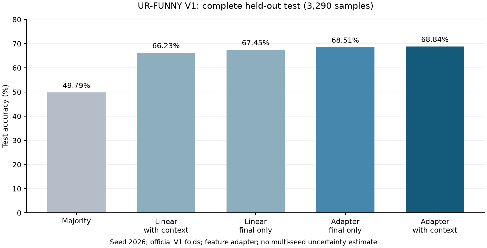

# AdaTrustMSA

**Reliable and Resource-Adaptive Multimodal Sentiment Analysis**

[](https://www.python.org/)
[](https://pytorch.org/)
[](LICENSE)
[](https://github.com/CMU-MultiComp-Lab/CMU-MultimodalSDK)

AdaTrustMSA is a PyTorch project for multimodal sentiment analysis with text,
audio, and visual signals. It combines reliability-aware deep fusion,
uncertainty estimation, controlled noise training, dynamic modality acquisition,
and temporal early exit in one reproducible pipeline.

The repository provides two experiment tracks:

1. a **project-oriented robust prediction track** for noisy, missing, and
   partially observed modalities; and
2. a **paper-comparable CMU-MOSEI track** using the standard MMSA aligned split,
   BERT-base, standard Acc-7/Acc-2/F1/MAE/Corr metrics, and validation-only
   checkpoint or ensemble selection.

This is an independent implementation. It is not an official implementation of
E-MoE, QA-MoE, or any other published method.

## Practical Application Scenarios

The completed experiments below support **predictor components** for practical
review tools. They do not measure a deployed product, review-time savings or
performance on a particular company's recordings. Importance is the proposed
operational value, distinguished from the benchmark measurement.

| Where it could be used | Predictor and why it matters | Dataset-backed evidence |
|---|---|---|
| Product-research teams and opinion-video review tools | Tag sentiment polarity/intensity so reviewers can organise feedback and inspect changing opinions | CMU-MOSEI: nonzero Acc2 **86.36%**, weighted F1 **0.8636**, MAE **0.5133**; 4,659 test segments |
| Conversation-review and customer-feedback research tools | Flag sentiment-bearing turns for human follow-up instead of reducing a whole conversation to one label | MELD: **68.07% accuracy / 0.6466 Macro-F1**; all 2,610 test utterances; text+audio only; TV-dialogue proxy |
| Chinese video platforms and media-asset libraries | Attach polarity/intensity tags to indexed clips, supporting filtered retrieval and human review | CH-SIMS v2(s): validation safeguard **81.56% Acc2 / 0.2982 MAE**; all 1,034 test clips |
| Dialogue annotation, interview replay and content-review tools | Present possible sarcasm with context before a reviewer interprets an utterance literally | MUStARD: validation safeguard **71.50% accuracy / 0.7149 Macro-F1**; five-fold coverage of all 690 examples per seed |
| Video assistants and intent-triage research tools | Separate requests, complaints, suggestions and other intents to help a person prioritise the next response | MIntRec: selected seed 2026 **74.83% accuracy / 0.7219 Macro-F1**; all 445 test utterances; TV-dialogue proxy |
| Public-talk archives and educational-video production teams | Review candidate humorous utterances with their setup when preparing excerpts or summaries | Preserved UR-FUNNY V1 result **68.84% accuracy / 0.6884 Macro-F1**; all 3,290 test samples; no new BGE result |

The MOSEI/MELD values are actual **RTX 4090 GPU** measurements from 2026-10-29,
averaged over three new BGE/LoRA branch seeds on fixed original backbones.
MUStARD/CH-SIMS are CPU task-adaptation results across three original backbone
seeds. MIntRec and the preserved UR-FUNNY result use their declared single primary
seed. These aggregation units and tasks must not be treated as one common ranking.

The new task adaptations retain old encoders/fusion and local-evidence/SAM heads,
then add a BGE CLS branch with LoRA where matched text is available. Chinese
sentiment uses Chinese BGE and regression; MELD has no vision input. These are
dataset-specific adaptations, not unchanged reconstructions of the complete
MIntRec BERT architecture. The original inference and adaptive-exit APIs below
remain separate from these documented experiments.

**Baseline status:** MOSEI/MELD improve their own original models. MUStARD remains
slightly below the measured SVM (**71.59%**). CH-SIMS improves Ridge MAE
(**0.2982 vs 0.3123**) but remains below Ridge Acc2 (**81.56% vs 82.11%**).
MIntRec's selected score is slightly above the actual same-seed TCL-MAP rerun
(**74.83% vs 74.61%**, one net correct example), with additional BGE capacity.
These results do not establish stable superiority over recent strong baselines
or state-of-the-art performance.

[Application settings, importance and workflows](docs/APPLICATION_SCENARIOS.md) ·
[Protocols, old/new comparisons and candidate results](docs/APPLICATION_EXPERIMENTS_20261029.md) ·
[Machine-readable evidence](docs/results/application_scenarios_20261029/metrics.json)

### Why These Scenarios Matter

- **Opinion-video analysis:** polarity and intensity provide complementary ways
  to organise large feedback collections. A segment index can preserve the
  expressed view and its context for a researcher to inspect. The experiment
  measures sentiment prediction, not product satisfaction or research efficiency.
- **Conversation sentiment review:** different turns can express different
  reactions. Per-turn tags could support a review queue, but MELD's scripted
  dialogue does not validate actual customer-call outcomes or service quality.
- **Chinese media retrieval:** sentiment metadata adds a way to browse speech
  clips beyond keywords alone. Retrieval relevance and editing time still need
  to be tested; the current benchmark measures the tagging component.
- **Sarcasm-aware review:** literal wording can misrepresent intended meaning.
  Keeping the target with its context gives a reviewer evidence to inspect;
  predictions remain review cues rather than automatic judgments about intent.
- **Intent triage:** emotion and requested action are different labels. Intent
  categories can help structure a response queue, while real support traffic
  and operational routing decisions require separate validation.

### Humor Review Assistance for Speech and Educational Videos

This application scenario targets **public-talk video archives, university
lecture-production teams, and online-course editors**. The intended workflow is
to flag potentially humorous utterances, retain their preceding context, and
present candidates for a person to review when preparing excerpts or summaries.
Recorded public talks are the closest tested domain; use on ordinary classroom
or online-course recordings is a proposed extension.

**Why this matters:** editors reviewing long recordings must find candidate
moments and check their surrounding discussion. A humor-review queue could
help prioritise that work and preserve the setup needed to understand a joke.
Humor can depend on wording, vocal delivery and visible expression, which makes
this a practical task for text/audio/visual fusion. This multimodal motivation
is supported by the [UR-FUNNY paper](https://aclanthology.org/D19-1211/).

The experiment below validates the **utterance-classification component** of
that proposed workflow. Review-time savings, clip-boundary quality, learning
outcomes and deployment on course recordings have not been measured.

### UR-FUNNY V1 Humor Classification

AdaTrustMSA's feature adapter was trained and evaluated on the official
**UR-FUNNY V1** train/validation/test folds for binary humor classification.
It uses supplied text, acoustic and visual features with up to eight preceding
context sentences, and reaches **68.84% accuracy / 0.6884 Macro-F1**
on all **3,290 held-out test samples**.

| Method | Test accuracy | Test Macro-F1 |
|---|---:|---:|
| Logistic regression with context | 66.23% | 0.6622 |
| AdaTrustMSA adapter, final utterance only | 68.51% | 0.6847 |
| **AdaTrustMSA adapter with context** | **68.84%** | **0.6884** |



These are **this project's measurements**, not the official UR-FUNNY paper's
results. This is a **single-seed feasibility experiment (seed 2026)** using
pre-extracted features and newly trained encoders/heads with the existing fusion
core. It evaluates humor classification; the original BERT/raw-video input path
and adaptive acquisition/early-exit policy are not evaluated here. V1 results
are not directly comparable with cleaned V2 results, and no state-of-the-art
claim is made.

[Official V1 data](https://github.com/ROC-HCI/UR-FUNNY/blob/master/UR-FUNNY-V1.md)
| [Application setting, importance and workflow](docs/UR_FUNNY_APPLICATION_SCENARIO.md)
| [Protocol, limitations and full results](docs/UR_FUNNY_V1_RESULTS.md)
| [Machine-readable metrics](docs/results/urfunny_v1_20261026/context_metrics.json)

## Highlights

- **Text-audio-visual modeling** with BERT and bidirectional recurrent modality
  encoders.
- **Reliability-aware deep fusion** using quality-conditioned multimodal
  interaction, explicit pairwise features, and gated modality/synergy experts.
- **Continuous Quality-Prior Attention (CQPA)** that injects reliability,
  uncertainty, and conflict information into cross-modal attention.
- **Aleatoric uncertainty estimation** through heteroscedastic sentiment
  regression.
- **Noise and missing-modality evaluation** for audio/visual Gaussian noise,
  contiguous feature occlusion, and all T/A/V availability combinations.
- **Adaptive modality acquisition** with a configurable `T -> T+A -> T+A+V`
  policy.
- **25% to 100% temporal early exit** with confidence and temporal-stability
  constraints.
- **Validation-selected Pareto checkpoint ensemble** for balancing standard
  CMU-MOSEI Acc-7, Acc-2, F1, MAE, and Corr.
- **Full experiment audit trail** through resolved configs, validation metrics,
  prediction CSV files, robustness grids, and machine-readable JSON outputs.

## Scope and Implemented Features

| Capability | Status | Description |
|---|---|---|
| Multimodal sentiment regression | Implemented | Predicts a continuous sentiment score from text, audio, and vision |
| Three-class sentiment prediction | Implemented | Negative, neutral, and positive classification |
| Reliability-aware fusion | Implemented | Estimates modality quality and down-weights unreliable evidence |
| Gaussian noise robustness | Implemented | Controlled audio/visual feature corruption at multiple severity levels |
| Local occlusion robustness | Implemented | Contiguous temporal masking for audio and visual features |
| Missing-modality evaluation | Implemented | Evaluates T, A, V, TA, TV, AV, and TAV availability |
| Uncertainty modeling | Implemented | Heteroscedastic regression variance and confidence-aware prediction |
| Dynamic modality acquisition | Implemented | Stops after T or T+A when confidence is sufficient |
| Temporal early exit | Implemented | Supports 25%, 50%, 75%, and 100% sequence prefixes |
| MOSEI-to-MOSI interface | Partial | Requires both datasets to use the same audio/visual feature spaces |
| Raw MP4/WAV feature extraction | Not included | The project consumes aligned or CSD computational features |

## Method Overview

### 1. Modality Encoders

- **Text:** a local Hugging Face BERT encoder followed by a bidirectional
  recurrent encoder.
- **Audio:** a bidirectional encoder over 74-dimensional COVAREP features.
- **Vision:** a bidirectional encoder over 35-dimensional FACET features.
- **Masks:** unobserved timesteps and missing modalities remain explicitly
  masked instead of being replaced by random synthetic features.

### 2. Quality and Uncertainty Estimation

Each modality receives three complementary signals:

- reliability estimated from the encoded modality state and observation ratio;
- predictive uncertainty estimated by a modality-specific uncertainty head;
- cross-modal conflict computed from differences among unimodal predictions.

CQPA converts these signals into a continuous quality prior:

```text
quality_m = reliability_m
            * exp(-uncertainty_penalty * uncertainty_m)
            * exp(-conflict_penalty * conflict_m)
```

The logarithm of this quality prior is added to the attention score of each
available modality. Low-quality evidence can still contribute, but it requires
stronger content evidence to receive a high attention weight.

### 3. Deep Multimodal Fusion

The default fusion path contains:

1. masked multi-head interaction over text, audio, and visual tokens;
2. explicit T-A, T-V, and A-V pairwise products and absolute differences;
3. text, audio, visual, and cross-modal synergy experts;
4. reliability/uncertainty/conflict-conditioned expert routing; and
5. a residual path from the original reliability-weighted representation.

The same fusion module is used for T-only, T+A, and T+A+V inference, allowing
the early-exit policy to cache already computed modality states.

### 4. Adaptive Inference

```text
25% prefix -> Text
                 | confidence sufficient?
                 +---- yes ----> output
                 |
                 no
                 v
              + Audio
                 | confidence sufficient?
                 +---- yes ----> output
                 |
                 no
                 v
              + Vision -> temporal stability check
                              |
                              no
                              v
                    50% -> 75% -> 100%
```

Each prediction can include the sentiment class, sentiment intensity,
confidence, predictive variance, exit prefix, modalities used, modality
reliabilities, and fusion weights.

## Repository Structure

```text
AdaTrustMSA/
├── configs/
│   ├── adatrustmsa.json
│   ├── adatrustmsa_deep_baseline.json
│   ├── adatrustmsa_deep_plus.json
│   ├── adatrustmsa_deep_temporal.json
│   ├── adatrustmsa_mosei_paper.json
│   └── adatrustmsa_mosei_pareto_finetune.json
├── docs/
│   ├── DEEP_FUSION_RESULTS.md
│   ├── MOSEI_PAPER_PROTOCOL_RESULTS.md
│   ├── SERVER_RUN.md
│   └── GITHUB_PUBLISH.md
├── scripts/
│   ├── download_mosei_csd.sh
│   ├── download_verified.py
│   ├── build_full_mosei.sh
│   ├── train_full_4090.sh
│   └── run_mosei_pareto_4090.sh
├── src/
│   ├── adatrustmsa_model.py
│   ├── adatrustmsa_metrics.py
│   ├── adatrustmsa_corruption.py
│   ├── adatrustmsa_policy.py
│   ├── prepare_data.py
│   ├── build_full_mosei_from_csd.py
│   ├── train.py
│   ├── evaluate.py
│   ├── evaluate_paper.py
│   ├── evaluate_pareto_ensemble.py
│   ├── cross_dataset_eval.py
│   ├── infer.py
│   └── run_ablation.py
├── tests/
├── RESULTS.md
├── environment.yml
├── requirements.txt
├── requirements-dev.txt
├── LICENSE
└── README.md
```

Datasets, pretrained BERT weights, trained checkpoints, and generated run
directories are intentionally excluded from the repository.

## Requirements

### Recommended Hardware

- Linux or Windows with a CUDA-capable GPU;
- one NVIDIA RTX 4090 with 24 GB VRAM for the provided training settings;
- at least 32 GB system memory for routine use;
- substantially more free disk space when downloading the full CSD feature
  files and preserving multiple BERT-base checkpoints.

CPU inference is supported but is significantly slower. Full BERT-base training
is intended for GPU execution.

### Software

- Python 3.10 or newer;
- PyTorch 2.x;
- Transformers 4.x;
- NumPy;
- scikit-learn;
- h5py;
- huggingface-hub.

The release dependencies are pinned in `requirements.txt`. The original RTX
4090 experiments were also verified with PyTorch 2.0.1 + CUDA 11.7 and
Transformers 4.41.2.

## Installation

### Option A: `venv`

```bash
git clone https://github.com/YOUR_NAME/AdaTrustMSA.git
cd AdaTrustMSA

python -m venv .venv
source .venv/bin/activate
# Windows PowerShell: .venv\Scripts\Activate.ps1

python -m pip install --upgrade pip
pip install -r requirements.txt
```

### Option B: Conda

```bash
conda env create -f environment.yml
conda activate adatrustmsa
```

For development tests:

```bash
pip install -r requirements-dev.txt
```

### Prepare a Local BERT Encoder

Training reads BERT from a local directory to keep server experiments
reproducible and independent of network availability.

```bash
hf download google-bert/bert-base-uncased \
  --local-dir models/bert-base-uncased

hf download prajjwal1/bert-mini \
  --local-dir models/bert-mini
```

The folder must contain at least a Hugging Face `config.json` and model weights.
The smaller project-oriented configuration may use a compatible BERT-mini
directory, while paper-comparable experiments use `bert-base-uncased`.

## Dataset Preparation

The repository supports two distinct data preparation protocols. Do not mix
their result tables.

### Protocol A: Standard MMSA Aligned CMU-MOSEI

Use this protocol for comparison with published MMSA-style results.

Expected split sizes:

| Split | Samples |
|---|---:|
| Train | 16,326 |
| Validation | 1,871 |
| Test | 4,659 |
| Total | 22,856 |

Expected SHA-256 for `aligned_50.pkl`:

```text
45eccfb748a87c80ecab9bfac29582e7b1466bf6605ff29d3b338a75120bf791
```

Convert the pickle into the internal NPZ format:

```bash
python src/prepare_data.py \
  --dataset mosei \
  --input /data/CMU_MOSEI/Processed/aligned_50.pkl \
  --output-dir /data/mosei_mmsa_standard
```

The converter validates split sizes by default and computes normalization
statistics from the training split only.

### Protocol B: Full CSD Feature Reconstruction

This protocol rebuilds aligned samples from the available CMU-MOSEI
computational sequences rather than relying on an opaque preprocessed pickle.
It uses TimestampedWords, COVAREP, VisualFacet, and Labels CSD files.

Clone the CMU Multimodal SDK for the official video-level folds:

```bash
git clone --depth 1 \
  https://github.com/CMU-MultiComp-Lab/CMU-MultimodalSDK.git \
  /data/CMU-MultimodalSDK
```

Download and verify the required CSD files:

```bash
HF_ENDPOINT=https://hf-mirror.com \
  bash scripts/download_mosei_csd.sh /data/mosei_csd
```

Build all labeled segments:

```bash
CSD_ROOT=/data/mosei_csd/data \
SDK_ROOT=/data/CMU-MultimodalSDK \
TOKENIZER_ROOT=models/bert-mini \
OUTPUT_ROOT=/data/mosei_full \
  bash scripts/build_full_mosei.sh
```

The current verified Labels CSD contains 23,259 rows. Official folds cover
22,860 rows; `--unassigned-policy train` places the remaining 399 labeled rows
in training. This is recorded as an extended all-label protocol and must not be
reported as the standard MMSA split.

Generated files include:

```text
train.npz
valid.npz
test.npz
preprocessing.json
data_contract.json
coverage_audit.json
sample_manifest.csv
```

`coverage_audit.json` records source rows, split allocation, missing modalities,
truncation, and non-finite source values. Missing observations remain zero with
explicit masks; they are not replaced with random features.

### Input Feature Shapes

| Modality | Representation | Standard shape |
|---|---|---|
| Text | BERT token IDs, attention mask, token-type IDs | `(N, 3, 50)` |
| Audio | COVAREP | `(N, 50, 74)` |
| Vision | FACET | `(N, 50, 35)` |

## Training

### 1. Project-Oriented Robust Model

```bash
python src/train.py \
  --data-root /data/mosei_full \
  --encoder models/bert-mini \
  --config configs/adatrustmsa.json \
  --output-dir runs/mosei_full_s2026 \
  --device cuda
```

The default project configuration enables corruption training, quality-prior
attention, uncertainty estimation, and resource-aware validation.

### 2. Paper-Comparable BERT-Base Baseline

```bash
python src/train.py \
  --data-root /data/mosei_mmsa_standard \
  --encoder models/bert-base-uncased \
  --config configs/adatrustmsa_mosei_paper.json \
  --output-dir runs/mosei_paper_s1111 \
  --device cuda
```

This run selects the best checkpoint using clean validation MMSA MAE.

### 3. Pareto Fine-Tuning

```bash
python src/train.py \
  --data-root /data/mosei_mmsa_standard \
  --encoder models/bert-base-uncased \
  --config configs/adatrustmsa_mosei_pareto_finetune.json \
  --output-dir runs/mosei_pareto_s1111 \
  --initialize-from runs/mosei_paper_s1111/best.pt \
  --device cuda
```

The fine-tuning stage adds fused Smooth-L1 regression and reliability-weighted
unimodal distillation. Its checkpoint is selected using a validation-only
Pareto score over Acc-7, non-zero Acc-2, non-zero F1, MAE, and Corr.

### 4. One-Command 4090 Pipeline

```bash
DATA_ROOT=/data/mosei_mmsa_standard \
ENCODER_ROOT=models/bert-base-uncased \
PYTHON_BIN=.venv/bin/python \
  bash scripts/run_mosei_pareto_4090.sh
```

This script trains the baseline, fine-tunes the Pareto model, and evaluates the
validation-selected checkpoint ensemble.

### Training Outputs

Each run directory can contain:

| File | Description |
|---|---|
| `best.pt` | Complete best checkpoint, model arguments, config, and validation record |
| `best_validation.json` | Metrics used to select the checkpoint |
| `resolved_config.json` | Exact configuration used for the run |
| `history.json` | Per-epoch losses and validation metrics |
| `summary.json` | Best epoch, runtime, parameter count, and checkpoint path |
| `warm_start_audit.json` | Audit of warm-start or full-checkpoint initialization |

## Configuration Reference

All main hyperparameters are controlled by JSON configuration files.

### Optimization

| Key | Meaning | Paper baseline | Pareto fine-tuning |
|---|---|---:|---:|
| `seed` | Random seed | 1111 | 1111 |
| `epochs` | Maximum epochs | 30 | 12 |
| `early_stopping_patience` | Epochs without validation improvement | 8 | 4 |
| `batch_size` | Training batch size | 16 | 16 |
| `eval_batch_size` | Evaluation batch size | 64 | 64 |
| `bert_lr` | BERT learning rate | `1e-5` | `5e-6` |
| `head_lr` | Non-BERT learning rate | `1e-4` | `1e-4` |
| `weight_decay` | AdamW weight decay | `1e-5` | `1e-2` |
| `warmup_fraction` | Linear warmup fraction | 0.10 | 0.05 |
| `gradient_clip` | Global gradient-norm limit | 1.0 | 1.0 |

### Model and Fusion

| Key | Description |
|---|---|
| `hidden` | Hidden width of modality encoders and fusion blocks |
| `dropout` | Dropout probability |
| `fusion_layers` | Number of multimodal interaction blocks |
| `fusion_heads` | Attention heads per interaction block |
| `fusion_expansion` | Feed-forward expansion factor |
| `quality_attention` | Enables Continuous Quality-Prior Attention |
| `quality_attention_strength` | Strength of the quality prior in attention |
| `uncertainty_penalty` | Penalty applied to uncertain modalities |
| `conflict_penalty` | Penalty applied to conflicting modalities |
| `bert_freeze_epochs` | Initial epochs with BERT frozen |
| `bert_unfreeze_top_layers` | Number of top BERT layers unfrozen afterward |

### Losses

`loss_weights` may control:

- fused classification cross-entropy;
- heteroscedastic regression;
- fused Smooth-L1 regression;
- reliability supervision;
- unimodal classification and regression;
- expert classification;
- unimodal-to-fused distillation;
- Brier calibration regularization.

Terms absent from a configuration default to zero weight.

### Robustness and Policy

| Key | Description |
|---|---|
| `corruption.probability` | Probability of applying corruption during training |
| `corruption.ratio_range` | Minimum and maximum corrupted temporal ratio |
| `corruption.gaussian_probability` | Gaussian noise versus occlusion probability |
| `corruption.cascade_dropout_probability` | Probability of cascading modality dropout |
| `policy.prefixes` | Candidate sequence fractions, normally 0.25/0.5/0.75/1.0 |
| `policy.modality_order` | Modality acquisition order |
| `policy.modality_threshold` | Confidence required before acquiring another modality |
| `policy.exit_threshold_candidates` | Validation grid for temporal exit confidence |
| `policy.minimum_exit_prefix` | Earliest allowed temporal exit |
| `policy.require_temporal_stability` | Requires predictions to remain stable before exit |

## Evaluation

### Standard Single-Checkpoint Metrics

```bash
PYTHONPATH=src python src/evaluate_paper.py \
  --data-root /data/mosei_mmsa_standard \
  --checkpoint runs/mosei_paper_s1111/best.pt \
  --output results/mosei_paper_test.json \
  --split test
```

This command reports standard raw-regression Acc-7, Acc-2 with and without zero,
F1, MAE, and Corr.

### Validation-Selected Pareto Ensemble

```bash
PYTHONPATH=src python src/evaluate_pareto_ensemble.py \
  --data-root /data/mosei_mmsa_standard \
  --regression-checkpoint runs/mosei_paper_s1111/best.pt \
  --classification-checkpoint runs/mosei_pareto_s1111/best.pt \
  --output results/mosei_pareto_ensemble_test.json \
  --device cuda
```

The script searches checkpoint mixing weights on the validation split, fixes the
selected weight, and then evaluates the test split. The reported final run chose
0.45 for the regression-oriented baseline and 0.55 for the Pareto model.

### Robustness and Early-Exit Evaluation

First select the policy on validation data:

```bash
python src/evaluate.py \
  --data-root /data/mosei_full \
  --checkpoint runs/mosei_full_s2026/best.pt \
  --output-dir results/mosei_valid \
  --split valid
```

Then apply the fixed policy to test data:

```bash
python src/evaluate.py \
  --data-root /data/mosei_full \
  --checkpoint runs/mosei_full_s2026/best.pt \
  --selected-policy results/mosei_valid/selected_policy.json \
  --output-dir results/mosei_test \
  --split test
```

Test evaluation refuses to select a new policy without a validation-generated
`selected_policy.json`.

Outputs include:

- `evaluation.json`;
- `robustness_grid.csv`;
- `policy_grid.csv`;
- `selected_policy_predictions.csv`;
- `selected_policy.json` or `applied_policy.json`.

## Results

### Original Pareto Ensemble: Historical Standard MMSA Results

The original ensemble is preserved below. The separate 2026-10-29 BGE extension
measured 86.36% nonzero Acc2 and 0.5133 MAE; see the application evidence above.

The test set contains 4,659 CMU-MOSEI segments. Acc-2 and F1 use the non-zero
protocol.

| Metric | AdaTrustMSA Pareto Ensemble | E-MoE aligned reference | Difference |
|---|---:|---:|---:|
| Acc-7 | 54.046% | 54.10% | -0.054 pp |
| Acc-2 | 85.250% | 85.30% | -0.050 pp |
| F1 | 85.225% | 85.30% | -0.075 pp |
| MAE | **0.5344** | 0.5360 | **0.0016 lower** |

The ensemble Corr is **0.7648**. The referenced E-MoE table does not report
Corr. MAE is better than the reference; the other three metrics are very close
but remain below it, so this repository does not claim to outperform E-MoE on
all metrics.

### Development History on the Same Standard Split

| Version | Acc-7 | Acc-2 | F1 | MAE | Corr |
|---|---:|---:|---:|---:|---:|
| CQPA + BERT-base baseline | **54.37%** | 84.45% | 84.43% | 0.5383 | 0.7562 |
| Pareto fine-tuned model | 53.42% | **85.305%** | **85.287%** | 0.5398 | **0.7665** |
| Final 0.45/0.55 ensemble | 54.046% | 85.250% | 85.225% | **0.5344** | 0.7648 |

### Project-Oriented Robust Prediction Protocol

These are three-class project metrics on the full CSD reconstruction protocol.
They are not directly comparable to the non-zero MMSA table above.

| Metric | Shallow Fusion | Deep Fusion | Deep Fusion + CQPA |
|---|---:|---:|---:|
| Accuracy | **0.6656** | 0.6615 | 0.6632 |
| Macro-F1 | 0.6217 | 0.6258 | **0.6272** |
| Weighted-F1 | 0.6598 | 0.6612 | **0.6628** |
| MAE | 0.5857 | 0.5772 | **0.5767** |
| Pearson | 0.7036 | 0.7093 | **0.7100** |
| ECE | 0.0592 | 0.0357 | **0.0352** |
| Brier | 0.4479 | 0.4438 | **0.4435** |

Additional early-exit, robustness, and protocol details are available in
[`RESULTS.md`](RESULTS.md) and the `docs/` directory.

## Standalone Inference

Each input pickle must contain a top-level `test` block with `text_bert`,
`audio`, and `vision` arrays matching the standard shapes.

```bash
python src/infer.py \
  --input-dir examples/aligned_samples \
  --checkpoint runs/mosei_full_s2026/best.pt \
  --selected-policy results/mosei_valid/selected_policy.json \
  --output results/predictions.csv \
  --device cuda
```

The output CSV contains the predicted class and intensity, confidence,
variance, exit prefix, modalities used, cumulative model calls, reliability,
and fusion information.

## Cross-Dataset Evaluation

The official pre-extracted MMSA files use different audio/visual dimensions for
MOSEI (74/35) and MOSI (5/20). Zero-padding them would not create a valid shared
feature space. The cross-dataset evaluator therefore checks compatibility and
stops when feature dimensions differ.

After extracting both datasets with the same feature pipeline, run:

```bash
python src/cross_dataset_eval.py \
  --target-data-root /data/mosi_shared_features \
  --checkpoint runs/mosei_full_s2026/best.pt \
  --selected-policy results/mosei_valid/selected_policy.json \
  --output-dir results/mosei_to_mosi \
  --split test
```

This particular CLI is a zero-shot transfer interface and does not fine-tune a
new domain adapter. The separately trained task adaptations in the application
evidence above use their own dataset-specific protocols; they do not change
this compatibility check or this CLI.

## Testing

```bash
python -m compileall src tests
python -m pytest -q
```

Individual checks can also be run directly:

```bash
python tests/test_prepare_data.py
python tests/test_full_csd_extractor.py
python tests/test_corruption.py
python tests/test_metrics.py
python tests/smoke_test.py
```

The smoke test requires PyTorch and Transformers. Data conversion tests do not
require a GPU.

## Reproducibility Notes

- All reported model or policy choices are made on validation data.
- Standard paper metrics use the raw continuous regression output.
- Project classification metrics use the three-class prediction path and are
  reported separately.
- Normalization statistics are computed from training data only.
- Dataset split counts and the standard pickle hash are validated.
- Random seeds, resolved configs, initialization audits, and per-epoch histories
  are saved with each run.
- Generated metrics are stored in JSON/CSV rather than copied from console text.

## Limitations

- The repository uses pre-extracted computational features and does not provide
  an end-to-end raw video/audio feature extractor.
- Original YouTube media are not distributed by this repository.
- The final Pareto ensemble loads two checkpoints and therefore has higher
  inference cost than a single model.
- Synthetic Gaussian noise and temporal occlusion do not cover every real-world
  corruption type.
- MOSEI-to-MOSI evaluation requires a shared feature extraction pipeline.
- The reported results are single-run measurements and should not be presented
  as a universal state-of-the-art claim.

## License

This project is released under the [MIT License](LICENSE).

The CMU-MOSEI dataset, CMU Multimodal SDK, pretrained encoders, and external
feature files remain subject to their respective licenses and terms of use.

## Citation and Acknowledgements

There is currently no project-specific paper citation. If you use this code,
please cite the original CMU-MOSEI dataset and any feature/toolkit sources used
in your experiment.

This project builds on the ecosystem around:

- [CMU Multimodal SDK](https://github.com/CMU-MultiComp-Lab/CMU-MultimodalSDK)
- [MMSA](https://github.com/thuiar/MMSA)
- [Hugging Face Transformers](https://github.com/huggingface/transformers)
- [PyTorch](https://github.com/pytorch/pytorch)

Contributions and reproducibility reports are welcome.
